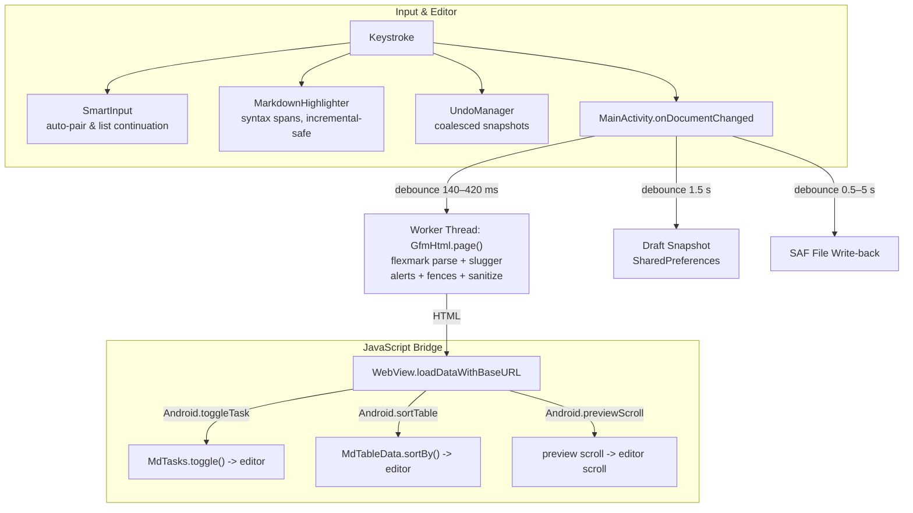

# MarkUltra — Native Android Markdown Editor & Viewer

[-blue?logo=android)](https://developer.android.com)
[](https://openjdk.org)
[](https://github.com/vladsch/flexmark-java)
[](https://github.com/sindresorhus/github-markdown-css)
[](#bundled-offline-engines)
[](LICENSE)
[](#dependency-budget)

**MarkUltra** is an lightweight, fully offline native Android Markdown editor and viewer built for 1:1 GitHub parity. 

Unlike conventional mobile Markdown apps that rely on simplified `TextView` renderers or basic CommonMark wrappers, MarkUltra runs the reference **flexmark-java** pipeline feeding GitHub’s authentic `.markdown-body` stylesheet in a hardened, sandboxed Android WebView. It bundles offline WebAssembly and JavaScript engines for LaTeX mathematics, chemical notation, and multiple diagramming specifications—all running entirely on-device with zero network requests.

```
Package      com.markultra.editor
minSdk       29  (Android 10)
targetSdk    34  (Android 14)
compileSdk   34
Language     Java 8 source level (no Kotlin runtime overhead, no Compose)
Engine       flexmark-java 0.64.8 (GFM) -> HTML -> WebView + GitHub stylesheet
Assets       KaTeX + mhchem + fonts (0.61 MB), Mermaid 10 (3.2 MB), 
             Graphviz / Viz.js WASM (1.38 MB), PlantUML / TeaVM (3.2 MB), Vega / Vega-Lite (0.73 MB)
Footprint    ~4.78 MB APK (unminified assemble), ~3.4 MB release with R8
Architecture 45 Java files, 18,699 lines + 855-line JVM test suite, 64 XML resources
Permissions  INTERNET (strictly for optional remote images; switchable off in Settings)
```

---

## Screenshots

| Dark Mode Preview | Light Mode Preview |
|:---:|:---:|
|  |  |

| Mathematics & LaTeX | Diagrams & Engines |
|:---:|:---:|
|  |  |

| Chemistry (mhchem) | Full Editor Interface |
|:---:|:---:|
|  |  |

---

## Markdown Stress Test

Included in this repository is [`markdown_viewer_stress_test_extended.md`](markdown_viewer_stress_test_extended.md), an exhaustive **63 KB, 40-section stress test suite** designed to push Markdown renderers to their absolute limits.

Tested against the full 40-section suite with 100% pass rate:

* **26 Complex Tables:** Standard GFM tables, pipe-escaped rows, empty cells, wide scrolling tables, and Pandoc multiline/grid tables. Headers feature **interactive tap-to-sort** which sorts the data and re-writes the markdown source.
* **16 Mermaid Diagrams:** Flowcharts, sequence diagrams, class models, state machines, and Gantt charts rendered 100% offline via Mermaid 10.9.1.
* **Specialized Visualization Engines:** Native support for **Graphviz** (DOT language compiled to WebAssembly via Viz.js), **PlantUML** (compiled to JS via TeaVM), and **Vega / Vega-Lite** data visualizations.
* **189 Task Checkboxes:** Interactive task lists (`- [ ]` / `- [x]`) that can be tapped directly inside the preview to mutate the underlying source file via a lightweight two-way JavaScript bridge.
* **33 LaTeX Math Expressions & Chemistry:** Inline `$E=mc^2$` and block `$$\int_0^\infty e^{-x^2} dx$$`, Pandoc `{=tex}` and `\[ ... \]` delimiters powered by bundled KaTeX 0.16.9 and 20 bundled WOFF2 font files. Full chemical equation typesetting via bundled `mhchem` (`\ce{2H2 + O2 -> 2H2O}`).
* **GitHub Admonition Alerts:** Authentic GitHub-styled alerts (`> [!NOTE]`, `> [!TIP]`, `> [!IMPORTANT]`, `> [!WARNING]`, `> [!CAUTION]`) with official GitHub SVG icons and color palettes.
* **100 Syntax-Highlighted Code Blocks:** 19 distinct token classes across C, C++, Java, Kotlin, Rust, Go, Python, JavaScript, TypeScript, Bash, SQL, JSON, YAML, XML, HTML, CSS, Diff, and Regex—with a one-click copy button on every block.
* **Strict HTML Sanitization:** Safe rendering of permissible HTML (`<details>`, `<summary>`, `<kbd>`, `<p align>`, inline SVG) while strictly neutralizing XSS threats (scripts, `onerror`, `javascript:` URIs).
* **Robust Typography & Unicode:** Bidirectional text support (Arabic, Hebrew), full emoji shortcodes (`:rocket:` -> 🚀), definition lists, abbreviations, superscripts, subscripts, footnotes with back-links, and YAML front-matter metadata cards.

---

## Features

MarkUltra implements **282 distinct features**, documented in complete detail in [`FEATURES.md`](FEATURES.md).

### 1. True 1:1 GitHub Parity
* Powered by **flexmark-java 0.64.8**—the gold standard CommonMark/GFM engine on the JVM.
* Uses GitHub's exact `.markdown-body` stylesheet with custom dynamic theme injection (Light, Dark, AMOLED, and 12 accent palettes).
* Identical slugging algorithm (`github-slugger`), ensuring all `#heading` anchor links jump precisely where expected.

### 2. Dual-Engine Architecture
* **Live WebView Preview:** For authentic web-grade rendering with CSS styling, KaTeX, Mermaid, and JS bridge interactions.
* **Pure-Java Native AST Engine:** Custom background lexer (`MdBlockParser`, `MdInlineParser`) for document outline, table of contents, text statistics, search/replace, linting, and export (RTF, HTML, Plain Text).

### 3. Interactive Preview-to-Source Bridge
* **Interactive Task Checkboxes:** Tap any checkbox in the preview pane; the JavaScript bridge dispatches `Android.toggleTask(index, checked)` which mutates the source text with byte-offset safety.
* **Column Sorting:** Tap table headers to sort rows ascending/descending directly in the markdown source.
* **Synchronized Scrolling:** Real-time synchronized scroll position between editor and preview in Split view mode.

### 4. Zero Lag & Intelligent Debouncing
* Typing throughput is decoupled from rendering via an adaptive preview debounce (140 ms default; 420 ms for documents above 120,000 characters).
* Document statistics and syntax highlighting run off-thread or are capped above 300,000 characters to keep soft-keyboard typing butter-smooth.

---

## Architecture

### Virtual Origin Asset Loading
Android 11+ and modern WebView policies heavily restrict access to `file:///android_asset/` sub-resources. MarkUltra solves this by serving all bundled engines through a custom internal scheme handled by `shouldInterceptRequest`:
```
https://appassets.androidplatform.net/assets/katex.min.js
https://appassets.androidplatform.net/assets/mermaid.min.js
https://appassets.androidplatform.net/assets/plantuml.js
```
This guarantees 100% offline access, same-origin compliance, and unblocked asset execution across all Android releases.

### Universal ES5 Polyfills for Older WebViews
Modern rendering bundles (Mermaid 10, Vega 5, PlantUML) require modern JavaScript features (`structuredClone`, `Object.hasOwn`, `WeakRef`, `String.prototype.replaceAll`). Older Android devices whose System WebView has not been updated would otherwise fail to load these engines. 

MarkUltra injects defensive polyfills into the HTML `<head>` prior to script execution:
```javascript
// Polyfills loaded conditionally only if unsupported:
structuredClone, Object.hasOwn, Object.fromEntries,
String.prototype.replaceAll, Array.prototype.at, Array.prototype.flat,
Promise.allSettled, queueMicrotask, WeakRef, FinalizationRegistry
```
Verified against Chrome 74, 84, 90, and modern Chromium releases.

---

## Third-Party Libraries

MarkUltra relies on world-class open-source libraries. All JavaScript engines ship bundled offline inside the APK. Detailed license terms are available in [`NOTICE-third-party.md`](NOTICE-third-party.md).

### Bundled JavaScript & WebAssembly Assets

| Library / Tool | Version | License | Role / Description |
|---|---|---|---|
| [**KaTeX**](https://katex.org) | 0.16.9 | MIT | High-speed offline TeX mathematical typesetting engine with bundled WOFF2 fonts |
| [**mhchem for KaTeX**](https://github.com/mhchem/mhchem) | 0.16.9 | MIT | Extension for typesetting chemical formulae and reactions (`\ce{...}`) |
| [**Mermaid**](https://mermaid.js.org) | 10.9.1 | MIT | Diagramming and charting tool (flowcharts, sequence, class, state diagrams) |
| [**Viz.js (Graphviz)**](https://github.com/hpcc-systems/visualization) | @viz-js/viz | MIT / EPL-1.0 | Graphviz compiled to WebAssembly for rendering `dot` / `graphviz` blocks |
| [**PlantUML**](https://plantuml.com) | 1.2026.9 | MIT | PlantUML compiled to JavaScript via [TeaVM](https://teavm.org) (`@plantuml/core`) |
| [**Vega**](https://vega.github.io/vega/) | 5.x | BSD-3-Clause | Declarative visualization grammar |
| [**Vega-Lite**](https://vega.github.io/vega-lite/) | 5.x | BSD-3-Clause | High-level grammar of interactive data graphics |

### Java & Android Dependencies

| Artifact | Version | License | Purpose |
|---|---|---|---|
| [**flexmark-java**](https://github.com/vladsch/flexmark-java) | 0.64.8 | BSD-2-Clause | Reference CommonMark / GFM parser and HTML renderer for the JVM + 18 extensions |
| [**jsoup**](https://jsoup.org) | 1.15.4 | MIT | Robust HTML parser for clipboard paste conversion and HTML sanitization |
| [**autolink-java**](https://github.com/robinst/autolink-java) | 0.11.0 | Apache-2.0 | High-efficiency link extraction for GitHub autolinks |
| **AndroidX Core & AppCompat** | 1.6.1 | Apache-2.0 | Foundational Android backward-compatible runtime components |
| **Google Material Components** | 1.9.0 | Apache-2.0 | Material Design UI widgets, dialogs, and navigation |

---

## Build

### Android Studio / CLI (JDK 17 + SDK 34)
```bash
./gradlew :app:assembleDebug     # Debug APK
./gradlew :app:assembleRelease   # Release APK
```

### On-Device with CodeAssist
Import or open the folder directly in CodeAssist and tap **Run** (`debug` or `release`).

### GitHub Actions CI
* **Debug APK:** Automatically built and published to GitHub Releases on push.
* **Release APK:** Can be triggered on demand via **Actions** → **Build & Publish Release APK**.

---

## 4. Dependency budget (measured)

### 4.1 What the app downloads

Three AndroidX dependencies plus the Markdown engine:

```groovy
implementation 'androidx.appcompat:appcompat:1.6.1'
implementation 'androidx.activity:activity:1.6.0'
implementation 'com.google.android.material:material:1.9.0'

implementation 'com.vladsch.flexmark:flexmark:0.64.8'
implementation 'com.vladsch.flexmark:flexmark-ext-tables:0.64.8'
implementation 'com.vladsch.flexmark:flexmark-ext-gfm-strikethrough:0.64.8'
implementation 'com.vladsch.flexmark:flexmark-ext-gfm-tasklist:0.64.8'
implementation 'com.vladsch.flexmark:flexmark-ext-autolink:0.64.8'
implementation 'com.vladsch.flexmark:flexmark-ext-footnotes:0.64.8'
implementation 'com.vladsch.flexmark:flexmark-ext-emoji:0.64.8'

// MarkUltra+ only
implementation 'com.vladsch.flexmark:flexmark-ext-definition:0.64.8'
implementation 'com.vladsch.flexmark:flexmark-ext-admonition:0.64.8'
implementation 'com.vladsch.flexmark:flexmark-ext-wikilink:0.64.8'
implementation 'com.vladsch.flexmark:flexmark-ext-attributes:0.64.8'
implementation 'com.vladsch.flexmark:flexmark-ext-abbreviation:0.64.8'
implementation 'com.vladsch.flexmark:flexmark-ext-aside:0.64.8'
implementation 'com.vladsch.flexmark:flexmark-ext-yaml-front-matter:0.64.8'
implementation 'com.vladsch.flexmark:flexmark-ext-gfm-users:0.64.8'
implementation 'com.vladsch.flexmark:flexmark-ext-gfm-issues:0.64.8'
implementation 'com.vladsch.flexmark:flexmark-ext-superscript:0.64.8'
implementation 'com.vladsch.flexmark:flexmark-ext-ins:0.64.8'
implementation 'com.vladsch.flexmark:flexmark-ext-resizable-image:0.64.8'

// Paste rich HTML as Markdown
implementation 'com.vladsch.flexmark:flexmark-html2md-converter:0.64.8'
implementation 'org.jsoup:jsoup:1.15.4'
```

flexmark is the reference CommonMark/GFM implementation for the JVM: no Kotlin, no
Android dependency, no reflection, and its nine `flexmark-util-*` runtime modules plus
the extensions above come to **~2.3 MB** in total (measured on the jars).

Their full transitive closure was resolved from the real POMs and every AAR/JAR was
downloaded and measured:

| Artifact | Size |
|---|---|
| `com.google.android.material:material:1.9.0` | 2.10 MB |
| `org.jetbrains.kotlin:kotlin-stdlib:1.7.10` (transitive via `core-ktx`) | 1.45 MB |
| `androidx.appcompat:appcompat:1.6.1` | 1.08 MB |
| `androidx.core:core:1.9.0` | 1.06 MB |
| `androidx.constraintlayout:constraintlayout:2.1.4` + `constraintlayout-core` | 0.87 MB |
| `androidx.recyclerview:recyclerview` | 0.39 MB |
| `androidx.fragment:fragment` | 0.32 MB |
| 51 further small artifacts (lifecycle, savedstate, emoji2, transition, vectordrawable, asm-free) | ~2.7 MB |
| `com.vladsch.flexmark` core + 12 `util` modules + 18 extensions | 1.55 MB |
| `org.nibor.autolink:autolink:0.11.0` (flexmark's autolink backend) | 0.02 MB |
| `org.jsoup:jsoup:1.15.4` (HTML parser behind the paste converter) | 0.44 MB |
| **Total library closure (86 artifacts, worst case)** | **12.75 MB** |

---

## 5. Architecture



* **Parsing is flexmark's job.** `GfmHtml` configures the GFM extension set once, runs
  the parse on a worker thread, then does what GitHub does afterwards: slug the headings,
  turn `> [!NOTE]` blocks into alert markup, highlight fences, number the task
  checkboxes, and pass the whole thing through `HtmlSanitize`.
* **Rendering is GitHub's CSS.** `GfmCss` is a single template with colour slots, so
  light, dark and AMOLED all come from the same rules — table borders, alert colours and
  code tokens included. Nothing about the page is hard coded per theme.
* **The WebView is a page, not a browser.** JavaScript is on because KaTeX, Mermaid and
  the checkbox bridge need it, but the page cannot navigate (http links leave for the
  browser), cannot reach the app except through three bridge methods, and cannot load
  anything the sanitiser removed. File access is limited to the open document's siblings,
  and `RelativeImage` refuses paths that climb out of that directory.
* **Analysis stays native.** `MdBlockParser`/`MdInlineParser` still power outline, stats,
  lint, search and the plain-text/RTF export — they track source offsets, which is what
  the outline and the HTML export need, and they are pure Java with no Android imports.
* **Theme** (`ThemeController`) resolves one `Colors` struct that feeds the editor, the
  page colours, the dialogs and the system bars — no duplicated colour constants.
* **Files** go exclusively through SAF. The only permission is `INTERNET`, used for
  remote images from a README; turn *Load images in preview* off and nothing leaves the
  device.

---

## 6. Markdown support

| Supported | Notes |
|---|---|
| ATX + Setext headings | H1–H6, cycle command |
| Bold, italic, bold+italic | CommonMark flanking rules, intraword `snake_case` safe |
| Strikethrough `~~x~~`, highlight `==x==` | |
| Inline code, fenced code (``` / ~~~), indented code | language tag shown as a chip |
| Links `[t](u)`, `[t](u "title")`, `<autolinks>`, bare URLs | clickable |
| Reference links `[t][id]` + `[id]: url` definitions | |
| Images `` | real bitmaps: remote http(s), `data:`, `content://`, and **relative paths** resolved against the open document |
| Ordered / unordered / nested lists, task lists | tap checkboxes in the preview to toggle |
| Block quotes (nested), horizontal rules | |
| GFM tables with alignment + sorting | tap a header cell to sort |
| Footnotes `[^1]` + definitions | rendered as GitHub does, with back-references |
| HTML entities, backslash escapes, hard breaks | |
| Raw HTML blocks | `<details>`, `<summary>`, `<kbd>`, `<p align>`, `<center>`, inline SVG: kept and sanitised like GitHub |
| GitHub alerts | `> [!NOTE]`, `TIP`, `IMPORTANT`, `WARNING`, `CAUTION` with GitHub's colours and icons |
| Inline + display maths | `$E = mc^2$`, `$$ ... $$`, ```math fences, rendered by KaTeX |
| Mermaid diagrams | ```mermaid fences, rendered by Mermaid 10 |
| Heading anchors | `github-slugger` ids, de-duplicated, so `[go](#quick-start)` works |
| Pandoc raw spans and blocks | `` `x`{=tex} ``, `` `x`{=html} ``, ```` ```{=tex} ````, ```` ```{=html} ```` |
| LaTeX delimiters | `\[ ... \]` display and `\( ... \)` inline, with Pandoc's escapes undone |
| Tables without pipes | Pandoc simple, multiline and grid tables, wrapped cells re-joined, alignment inferred |
| Definition lists, superscript, subscript | `Term` / `: def`, `x^2^`, `H~2~O` - in both profiles |
| YAML front matter | shown as one metadata card at the top of the document |
| Copy button | on every code block, copies the exact source |
| Syntax highlighting | 19 token classes across C-family, Python, shell, SQL, JSON, HTML/XML, CSS, plus line-coloured `diff` |
| Emoji | `:rocket:` renders as the real emoji, `:name:` shortcodes GitHub knows |
| Smart typography (curly quotes, –, —, …) | toggleable, applied before parsing |

Not supported: MDX/JSX and GitHub-only widgets (issue/PR prefill links). Relative paths
that point outside the open document's folder are refused rather than guessed.

---

---

## Why MarkUltra? (Feature Summary)

* **1:1 GitHub Flavored Markdown (GFM):** Tables, task lists, alerts (`> [!NOTE]`), footnotes, emoji shortcodes (`:rocket:`), strikethrough, autolinks, and heading anchors.
* **Offline LaTeX Math & Chemistry:** Typeset inline `$E=mc^2$` and block equations via KaTeX 0.16.9 + chemical formulas via `mhchem` (`\ce{2H2 + O2 -> 2H2O}`).
* **Built-in Diagramming Engines:** Native rendering for Mermaid 10 (flowcharts, sequence, class, state diagrams, Gantt), Graphviz (DOT language via WebAssembly), PlantUML (TeaVM), and Vega/Vega-Lite data graphics.
* **Interactive Preview-to-Source Bridge:** Tap checkboxes in preview to update markdown source; tap table headers to sort rows.
* **Native Performance & Small Footprint:** Pure Java 8, zero Kotlin/Compose runtime bloat (~4.8 MB APK), smooth inertial fling scrolling, and 100% offline local asset loading via virtual origin `https://appassets.androidplatform.net/`.

## License

This project is licensed under the [MIT License](LICENSE).
