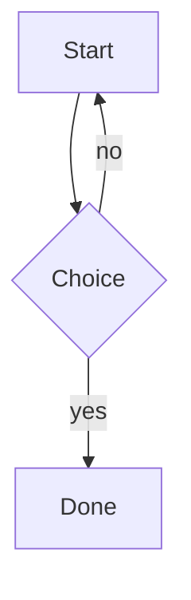
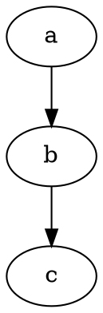

# Engines

## Mermaid



## Vega

```vega-lite
{
  "data": {"values": [{"category":"A","value":20},{"category":"B","value":35}]},
  "mark": "bar",
  "encoding": {
    "x": {"field": "category", "type": "nominal"},
    "y": {"field": "value", "type": "quantitative"}
  }
}
```

## Graphviz



## Maths

Inline: $E = mc^2$ and $\frac{a}{b}$ and chemistry $\ce{2H2 + O2 -> 2H2O}$.

Display:

$$\int_0^1 x^2\,dx = \frac{1}{3}$$

Block chemistry:

$$\ce{CH4 + 2O2 -> CO2 + 2H2O}$$

Moles: $\pu{1.5e-3 M}$.
