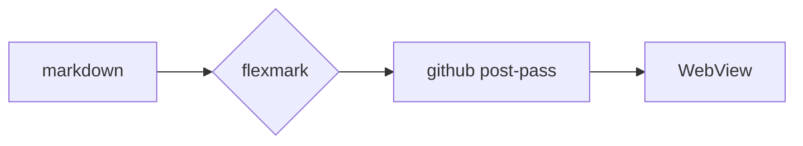

# MarkUltra — rendering showcase

<p align="center">
  
  
  
</p>

Every block below is rendered by the same pipeline the app uses: **flexmark-java** for
parsing, a GitHub post-pass for the shapes GitHub adds, and github-markdown-css for the
look. Nothing here is a screenshot of a mock-up.

## Text, links and inline code

A paragraph with **bold**, _italic_, ~~struck~~, `inline code`, a [link](https://github.com),
an autolink https://spec.commonmark.org, and a footnote reference[^1]. Two spaces at the
end of this line force a hard break,  
like this. A backslash escape keeps \*asterisks\* literal.

> A blockquote that spans
> two source lines.

> [!NOTE]
> Useful information that users should know, even when skimming content.

> [!TIP]
> Helpful advice for doing things better or more easily.

> [!IMPORTANT]
> Key information users need to know to achieve their goal.

> [!WARNING]
> Urgent info that needs immediate user attention to avoid problems.

> [!CAUTION]
> Advises about risks or negative outcomes of certain actions.

## Lists

- Unordered item
- Item with a nested list
  - Nested item
    - Deeper still
- Item with `code`

1. Ordered item
2. Second item
   1. Nested ordered
3. Third item

- [x] Task list item, checked
- [ ] Task list item, open
  - [x] Nested task, checked
  - [ ] Nested task, open

## Tables

| Option | Type | Default | Notes |
|:-------|:----:|--------:|:------|
| `theme` | string | `system` | follows the OS |
| `font` | int | `16` | editor size in sp |
| `wrap` | bool | `true` | soft wrap in the editor |

## Code

```java
public class Hello {
    // greetings
    public static void main(String[] args) {
        System.out.println("Hi");
    }
}
```

```python
def render(text: str) -> str:
    """Parse markdown and return HTML."""
    return PARSER.convert(text)  # the hot path
```

```bash
for f in *.md; do
  echo "rendering $f"
done
```

## Maths

Inline maths $E = mc^2$ sits in a sentence, and display maths gets its own block:

$$
\int_{0}^{\infty} e^{-x^2}\,dx = \frac{\sqrt{\pi}}{2}
$$

## Diagram



## Details and keys

<details>
<summary>Click to reveal the answer</summary>

The answer is <kbd>Ctrl</kbd> + <kbd>S</kbd> — the file saves itself anyway.

</details>

## Images


---

That horizontal rule above is a `---` line, and the footnote below is real Markdown
footnote syntax, not a hand-written note.

[^1]: The note itself, rendered by flexmark's footnote extension and reshaped into
    GitHub's `<section data-footnotes>` markup.
