# Markdown Viewer Stress Test 🚀

> **Purpose:** This document is intentionally large and varied. Use it
> to test parsing, rendering, layout, scrolling, syntax highlighting,
> links, images, tables, task lists, math, raw HTML, and edge cases.
>
> A good viewer should render supported features cleanly and handle
> unsupported extensions gracefully---without crashing or corrupting the
> rest of the document.

[TOC](#table-of-contents) · [GitHub](https://github.com/) · [Markdown
Guide](https://www.markdownguide.org/)

------------------------------------------------------------------------

## Table of Contents

1.  [Headings](#heading-levels)
2.  [Paragraphs and inline
    formatting](#paragraphs-and-inline-formatting)
3.  [Lists](#lists)
4.  [Links and references](#links-and-references)
5.  [Images](#images)
6.  [Blockquotes and alerts](#blockquotes-and-github-alerts)
7.  [Code blocks](#code-blocks)
8.  [Tables](#tables)
9.  [Task lists](#task-lists)
10. [Footnotes](#footnotes)
11. [Math](#mathematics)
12. [HTML](#raw-html)
13. [Diagrams](#diagrams-and-mermaid)
14. [Emoji and Unicode](#emoji-and-unicode)
15. [Escaping and edge cases](#escaping-and-parser-edge-cases)
16. [Long content](#long-content-and-layout-stress)
17. [Final checklist](#renderer-test-checklist)

------------------------------------------------------------------------

# Heading Levels

# Heading 1

## Heading 2

### Heading 3

#### Heading 4

##### Heading 5

###### Heading 6

Heading with **bold**, *italic*, `inline code`, and a
[link](https://example.com).

Heading containing punctuation: `C++`, `C#`, `Node.js`, `foo_bar`, and
`x.y/z`.

# Setext-style heading

## Another Setext heading

------------------------------------------------------------------------

# Paragraphs and Inline Formatting

This is a normal paragraph. It contains enough text to wrap onto
multiple lines on a phone screen. A Markdown viewer should preserve
readable spacing, avoid horizontal overflow, and keep line height
comfortable.

This paragraph contains **bold text**, **also bold**, *italic text*,
*also italic*, ***bold and italic***, ~~deleted text~~, and
`inline code`. Here is a [normal link](https://example.com) and an
automatic URL: https://www.wikipedia.org/.

You can combine formatting: **bold with *italic inside***, ~~deleted
with `code`~~, and ***bold italic with a [link](https://example.com)***.

Superscript-like text: x^2^ (extension-dependent). Subscript-like text:
H~2~O (extension-dependent).

Escaped characters: \*not italic\*, \_not italic\_, \`not code\`, and \#
not a heading.

A hard line break follows.\
This should appear on the next line.

A soft line break should normally remain part of the same paragraph,
depending on the renderer.

Inline symbols: © ® ™ § ¶ † ‡ • ... --- -- «quoted» "curly quotes"
'apostrophe'.

------------------------------------------------------------------------

# Lists

## Unordered lists

-   First item

-   Second item

    -   Nested item A
    -   Nested item B
        -   Third level
            -   Fourth level

-   Final item

-   Asterisk marker

-   Another asterisk item

-   Plus marker

-   Another plus item

## Ordered lists

1.  First

2.  Second

3.  Third

    1.  Nested one
    2.  Nested two
        1.  Deep nested item

4.  Fourth

5.  Repeated numbering is often normalized.

6.  Another item.

7.  Yet another item.

## Mixed lists

1.  Install the app.
    -   Open settings.
    -   Select a theme.
2.  Load a document.
    -   [ ] Check rendering.
    -   [x] Check scrolling.
3.  Export the result.

## List items with paragraphs

-   This is the first paragraph in an item.

    This is a second paragraph in the same item. It should remain
    grouped with the first item.

-   This is another item with a code fragment:

    ``` bash
    echo "Nested code block"
    ```

## Definition-list-like content

Term A
:   Definition A. Some Markdown engines support this extension.

Term B
:   Definition B, with **bold text** and a [link](https://example.com).

------------------------------------------------------------------------

# Links and References

-   [Example](https://example.com)
-   [Link with title](https://example.com "Example website")
-   <https://example.org>
-   [mailto:hello@example.com](mailto:hello@example.com){.uri}
-   [Relative link](./README.md)
-   [Parent directory](../)
-   [Anchor link](#tables)
-   [Query string](https://example.com/search?q=markdown&sort=latest)
-   [URL with
    parentheses](https://en.wikipedia.org/wiki/Function_(mathematics))

Reference-style link: [OpenAI](https://openai.com "OpenAI").

Another reference link: [GitHub](https://github.com "GitHub").

Autolink email: contact@example.com

Link text with formatting: [**Bold link**](https://example.com).

Bare URL with punctuation: https://example.com/path\_(test).

------------------------------------------------------------------------

# Images

Inline image (network access may be required):


Image with reference syntax:


Image with descriptive alt text:


Image sizing and alignment are renderer-specific. Test whether images: -
Stay within the viewport. - Preserve aspect ratio. - Support tap-to-zoom
if implemented. - Display alt text when loading fails. - Avoid
stretching or covering nearby text.

Broken image test:


------------------------------------------------------------------------

# Blockquotes and GitHub Alerts

> This is a basic blockquote.
>
> It contains multiple paragraphs.
>
> **Formatting inside a quote works too.**

> Nested quote:
>
> > A second level.
> >
> > > A third level.

> A quote with a list:
>
> -   Alpha
> -   Beta
> -   Gamma

> A quote with code:
>
> ``` python
> print("Quoted code")
> ```

## GitHub Alerts

> \[!NOTE\] This is a note alert. It contains useful additional
> information.

> \[!TIP\] This is a tip alert. Try a different theme or text scale.

> \[!IMPORTANT\] This is important information that should be easy to
> notice.

> \[!WARNING\] This is a warning. Check contrast and icon alignment.

> \[!CAUTION\] This is a caution alert. Avoid hiding the message on
> small screens.

> \[!NOTE\] Custom title support Some renderers support custom alert
> titles; others show the default title or plain quote.

------------------------------------------------------------------------

# Code Blocks

## Plain text

``` text
Plain text block
    Indentation is meaningful.
Symbols: < > & " ' / \ | { } [ ] ( )
```

## Bash / Shell

``` bash
#!/usr/bin/env bash
set -euo pipefail

APP_NAME="Markdown Viewer"
VERSION="1.0.0"

echo "Building ${APP_NAME} v${VERSION}"

for file in *.md; do
    [[ -e "$file" ]] || continue
    printf 'Found: %s\n' "$file"
done

# A comment with Unicode: 🚀
```

## Python

``` python
from dataclasses import dataclass
from typing import Iterable

@dataclass
class Result:
    name: str
    score: float
    passed: bool = False

def evaluate(values: Iterable[float]) -> Result:
    numbers = list(values)
    if not numbers:
        raise ValueError("At least one value is required")

    mean = sum(numbers) / len(numbers)
    return Result(
        name="sample",
        score=mean,
        passed=mean >= 0.75,
    )

if __name__ == "__main__":
    result = evaluate([0.9, 0.8, 0.7])
    print(f"{result.name}: {result.score:.3f} ({result.passed=})")
```

## JavaScript

``` javascript
const users = [
  { id: 1, name: "Ada", active: true },
  { id: 2, name: "Linus", active: false },
];

const activeNames = users
  .filter((user) => user.active)
  .map(({ name }) => name);

console.log(`Active users: ${activeNames.join(", ")}`);

async function loadData(url) {
  const response = await fetch(url);
  if (!response.ok) {
    throw new Error(`HTTP ${response.status}`);
  }
  return response.json();
}
```

## TypeScript

``` typescript
type Status = "idle" | "loading" | "success" | "error";

interface ApiResponse<T> {
  data: T;
  status: number;
  message?: string;
}

async function request<T>(url: string): Promise<ApiResponse<T>> {
  const response = await fetch(url);
  const data = (await response.json()) as T;

  return {
    data,
    status: response.status,
  };
}
```

## Java

``` java
import java.util.List;
import java.util.stream.Collectors;

public class Main {
    public static void main(String[] args) {
        List<Integer> values = List.of(1, 2, 3, 4, 5);

        List<Integer> squares = values.stream()
            .map(n -> n * n)
            .collect(Collectors.toList());

        System.out.println(squares);
    }
}
```

## Kotlin

``` kotlin
data class User(
    val id: Int,
    val name: String,
    val active: Boolean = true
)

fun main() {
    val users = listOf(
        User(1, "Ada"),
        User(2, "Grace", active = false)
    )

    users.filter { it.active }
        .forEach { println(it.name) }
}
```

## C

``` c
#include <stdio.h>
#include <stdint.h>

int main(void) {
    uint32_t value = 42;
    printf("Value: %u\n", value);
    return 0;
}
```

## C++

``` cpp
#include <iostream>
#include <vector>
#include <numeric>

int main() {
    const std::vector<int> values{1, 2, 3, 4, 5};
    const int total = std::accumulate(values.begin(), values.end(), 0);

    std::cout << "Total = " << total << '\n';
    return 0;
}
```

## Rust

``` rust
fn main() {
    let values = vec![1, 2, 3, 4, 5];
    let total: i32 = values.iter().sum();

    println!("Total = {total}");
}
```

## Go

``` go
package main

import "fmt"

func main() {
    values := []int{1, 2, 3, 4, 5}
    total := 0

    for _, value := range values {
        total += value
    }

    fmt.Println("Total:", total)
}
```

## SQL

``` sql
SELECT
    category,
    COUNT(*) AS item_count,
    ROUND(AVG(score), 2) AS average_score
FROM results
WHERE created_at >= DATE '2026-01-01'
GROUP BY category
HAVING COUNT(*) > 2
ORDER BY average_score DESC;
```

## JSON

``` json
{
  "app": "Markdown Viewer",
  "version": "1.0.0",
  "features": [
    "tables",
    "task-lists",
    "syntax-highlighting",
    "math"
  ],
  "enabled": true,
  "limits": {
    "maxImageWidth": 1200,
    "cache": null
  }
}
```

## YAML

``` yaml
name: markdown-viewer
version: 1.0.0
features:
  - gfm
  - tables
  - task-lists
  - strikethrough
settings:
  theme: system
  lineNumbers: true
```

## XML

``` xml
<?xml version="1.0" encoding="UTF-8"?>
<document version="1">
  <title>Markdown Test</title>
  <item enabled="true">Hello &amp; welcome</item>
</document>
```

## HTML

``` html
<!doctype html>
<html lang="en">
  <head>
    <meta charset="utf-8">
    <title>Test</title>
  </head>
  <body>
    <main id="app">
      <h1>Hello Markdown</h1>
      <p>HTML code should be highlighted, not executed.</p>
    </main>
  </body>
</html>
```

## CSS

``` css
:root {
  color-scheme: light dark;
  --space: 1rem;
}

.card {
  display: grid;
  gap: var(--space);
  border: 1px solid currentColor;
  border-radius: 12px;
  padding: calc(var(--space) * 1.5);
}
```

## Diff

``` diff
- const renderer = new OldRenderer();
+ const renderer = new MarkdownRenderer({
+   gfm: true,
+   breaks: false,
+ });
```

## Regex

``` regex
^(?<date>\d{4}-\d{2}-\d{2})\s+(?<level>INFO|WARN|ERROR)\s+(?<message>.*)$
```

## Markdown inside code (must stay literal)

``` markdown
# This is not a real heading

- [ ] This is not a real task checkbox.
- **This is literal Markdown syntax.**

> This is only code.
```

## Long code line

``` text
THIS_IS_AN_INTENTIONALLY_LONG_LINE_0123456789_ABCDEFGHIJKLMNOPQRSTUVWXYZ_abcdefghijklmnopqrstuvwxyz_0123456789_ABCDEFGHIJKLMNOPQRSTUVWXYZ_abcdefghijklmnopqrstuvwxyz_0123456789_ABCDEFGHIJKLMNOPQRSTUVWXYZ_abcdefghijklmnopqrstuvwxyz_0123456789_ABCDEFGHIJKLMNOPQRSTUVWXYZ_abcdefghijklmnopqrstuvwxyz_0123456789_ABCDEFGHIJKLMNOPQRSTUVWXYZ_abcdefghijklmnopqrstuvwxyz
```

------------------------------------------------------------------------

# Tables

## Basic table

  Feature           Supported? Notes
  --------------- ------------ -----------------
  Headings                 Yes H1--H6
  Bold                     Yes Strong emphasis
  Italic                   Yes Emphasis
  Strikethrough            GFM Deleted text
  Tables                   GFM Pipe tables
  Task lists               GFM Checkboxes

## Alignment

  Left aligned           Center aligned    Right aligned
  --------------------- ---------------- ---------------
  Apple                      Banana                  100
  Orange                     Grapes                  250
  A longer cell value        Middle              3.14159

## Formatting inside cells

  Feature   Example
  --------- -----------------------------
  Bold      **Important**
  Italic    *Emphasis*
  Code      `const x = 1`
  Link      [Open](https://example.com)
  Strike    ~~Old value~~
  Mixed     **Bold** and *italic*

## Wide table

  -------------------------------------------------------------------------------------
            ID Component   Input        Expected     Priority   Status    Remarks
                                        output                            
  ------------ ----------- ------------ ------------ ---------- --------- -------------
           001 Parser      `# Title`    Heading      High       Pass      Basic syntax

           002 Parser      `**text**`   Bold         High       Pass      Inline
                                                                          formatting

           003 Renderer    Large image  Scaled image Medium     Pending   Check screen
                                                                          width

           004 Renderer    Long         Wrapped or   High       Pending   Avoid layout
                           unbroken     scrollable                        break
                           string                                         

           005 Renderer    Wide table   Horizontal   Medium     Pending   Preserve
                                        scroll                            columns

           006 Code        1000-line    Scrollable   High       Pending   Performance
                           block        block                             test
  -------------------------------------------------------------------------------------

## Table with escaped pipes

  Expression   Meaning
  ------------ ---------------------------
  `a \| b`     A pipe inside inline code
  `x \| y`     Another pipe
  `\|`         Literal pipe

## Empty cells

  A       B       C
  ------- ------- -------
  Value           Value
          Empty   
  Value   Value   

------------------------------------------------------------------------

# Task Lists

-   [x] Parse headings
-   [x] Parse paragraphs
-   [x] Parse emphasis
-   [ ] Test images
-   [ ] Test dark theme
-   [ ] Test light theme
-   [ ] Test horizontal scrolling
-   [ ] Test copy-code button
-   [ ] Test link opening
-   [ ] Test accessibility labels

Nested tasks:

-   [ ] Main task
    -   [x] Completed subtask
    -   [ ] Pending subtask
        -   [ ] Deep pending subtask
-   [x] Another completed task

------------------------------------------------------------------------

# Footnotes

Here is a sentence with a footnote.[^1]

Here is another footnote reference.[^2]

A repeated reference to the first footnote.[^3]

------------------------------------------------------------------------

# Mathematics

Inline equation: (E = mc\^2).

Another inline expression:
(`\displaystyle `{=tex}`\sum`{=tex}\_{i=1}\^{n} i =
`\frac{n(n+1)}{2}`{=tex}).

Block equation:

\[ `\int`{=tex}\_{-`\infty`{=tex}}\^{`\infty`{=tex}} e^{-x^2},dx =
`\sqrt{\pi}`{=tex} \]

Quadratic formula:

\[ x = `\frac{-b \pm \sqrt{b^2 - 4ac}}{2a}`{=tex} \]

Matrix:

\[ A =
```{=tex}
\begin{bmatrix}
1 & 2 & 3 \\
4 & 5 & 6 \\
7 & 8 & 9
\end{bmatrix}
```
\]

Piecewise function:

\[ f(x) =
```{=tex}
\begin{cases}
x^2, & x \geq 0 \\
-x, & x < 0
\end{cases}
```
\]

Greek letters: (`\alpha`{=tex}, `\beta`{=tex}, `\gamma`{=tex},
`\Delta`{=tex}, `\theta`{=tex}, `\lambda`{=tex}, `\mu`{=tex},
`\pi`{=tex}, `\sigma`{=tex}, `\omega`{=tex}).

Limits:

\[ `\lim`{=tex}\_{x `\to 0`{=tex}} `\frac{\sin x}{x}`{=tex} = 1 \]

Derivative:

\[ `\frac{d}{dx}`{=tex}`\left`{=tex}(x\^n`\right`{=tex}) = nx\^{n-1} \]

Probability:

\[ P(A `\mid `{=tex}B) = `\frac{P(A \cap B)}{P(B)}`{=tex} \]

Vector:

\[ `\vec{v}`{=tex} = `\langle 3`{=tex}, -2, 5 `\rangle`{=tex} \]

Chemical expression: (2H_2 + O_2 `\rightarrow `{=tex}2H_2O).

Math rendering is an optional extension. If unsupported, the viewer
should at least show the source clearly and keep the rest of the
document readable.

------------------------------------------------------------------------

# Raw HTML

The following tests depend on the renderer's HTML policy. A safe viewer
should sanitize unsafe HTML and never execute scripts.

<div>

`<strong>`{=html}Bold HTML`</strong>`{=html} `<em>`{=html}Italic
HTML`</em>`{=html} Inline span

</div>

```{=html}
<details>
```
```{=html}
<summary>
```
Expandable section --- click me
```{=html}
</summary>
```
This content is hidden until expanded.

-   Hidden item one
    -   Hidden item two

    ``` js
    console.log("Inside details");
    ```

```{=html}
</details>
```
```{=html}
<details open>
```
```{=html}
<summary>
```
Open by default
```{=html}
</summary>
```
This section starts expanded.
```{=html}
</details>
```
`<kbd>`{=html}Ctrl`</kbd>`{=html} + `<kbd>`{=html}Shift`</kbd>`{=html} +
`<kbd>`{=html}P`</kbd>`{=html}

`<mark>`{=html}Highlighted HTML text`</mark>`{=html}

`<small>`{=html}Small HTML text`</small>`{=html}

`<sub>`{=html}Subscript`</sub>`{=html} and
`<sup>`{=html}superscript`</sup>`{=html}

`<abbr title="GitHub Flavored Markdown">`{=html}GFM`</abbr>`{=html}

```{=html}
<del>
```
Deleted HTML text
```{=html}
</del>
```
and `<ins>`{=html}Inserted HTML text`</ins>`{=html}

```{=html}
<blockquote>
```
```{=html}
<p>
```
HTML blockquote with a `<strong>`{=html}bold phrase`</strong>`{=html}.
```{=html}
</p>
```
```{=html}
</blockquote>
```
```{=html}
<pre>
  Preformatted HTML text
      with indentation
</pre>
```
Horizontal rule using HTML:

```{=html}
<hr>
```
A raw HTML table:

```{=html}
<table>
```
```{=html}
<thead>
```
```{=html}
<tr>
```
```{=html}
<th>
```
Browser
```{=html}
</th>
```
```{=html}
<th>
```
Rendering
```{=html}
</th>
```
```{=html}
</tr>
```
```{=html}
</thead>
```
```{=html}
<tbody>
```
```{=html}
<tr>
```
```{=html}
<td>
```
Mobile
```{=html}
</td>
```
```{=html}
<td>
```
Responsive
```{=html}
</td>
```
```{=html}
</tr>
```
```{=html}
<tr>
```
```{=html}
<td>
```
Desktop
```{=html}
</td>
```
```{=html}
<td>
```
Wide layout
```{=html}
</td>
```
```{=html}
</tr>
```
```{=html}
</tbody>
```
```{=html}
</table>
```
Unsafe HTML test --- this must **not** execute:

```{=html}
<script>
  alert("A Markdown viewer must not execute embedded scripts!");
</script>
```
```{=html}
<iframe src="https://example.com" title="Embedded page test">
```
```{=html}
</iframe>
```

------------------------------------------------------------------------

# Diagrams and Mermaid

Mermaid support is an extension. If unavailable, display the source as a
code block.

## Flowchart

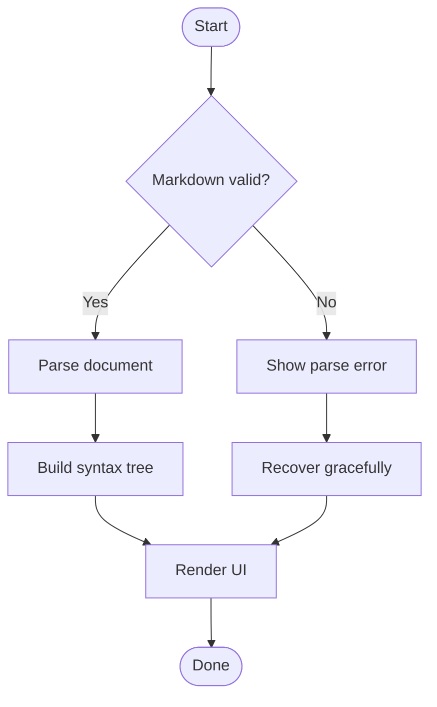

## Sequence diagram

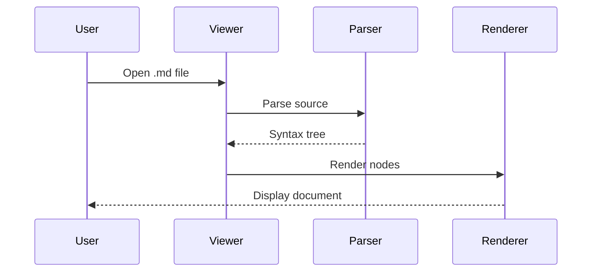

## Class diagram

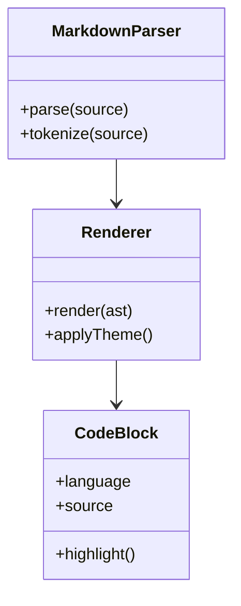

## State diagram

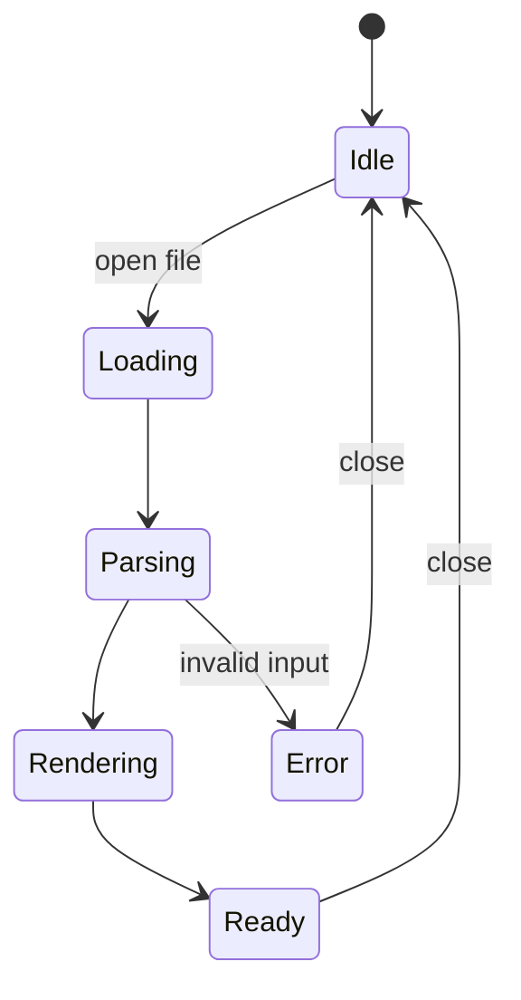

## Gantt chart

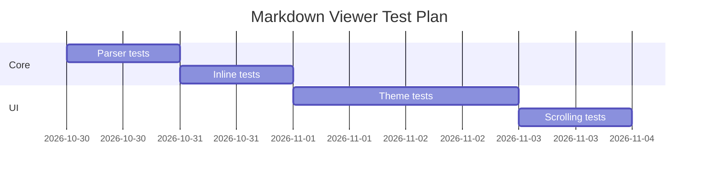

------------------------------------------------------------------------

# Emoji and Unicode

## Emoji

😀 😃 😄 😁 😆 😅 😂 🙂 🙃 😉 😊 😍 🥰 😎 🤓 🥳 🤯 🫠 🫡 🥲

🚀 🧪 🔬 💻 📱 🖥️ ⚙️ 🛠️ 📦 🧩 🔋 🌍 🌈 🔥 💡

Flags: 🇮🇳 🇺🇸 🇬🇧 🇯🇵 🇩🇪 🇫🇷

Skin tones and joined emoji: 👋 👋🏻 👋🏽 👋🏿 · 👨‍👩‍👧‍👦 · 🧑‍💻 · 🏳️‍🌈

## Multiple writing systems

-   English: Markdown is a lightweight markup language.
-   हिन्दी: नमस्ते! यह Markdown रेंडरिंग टेस्ट है।
-   मराठी: नमस्कार! हा मराठी मजकूर आहे.
-   বাংলা: এটি একটি পরীক্ষামূলক বাক্য।
-   தமிழ்: இது ஒரு சோதனை உரை.
-   తెలుగు: ఇది ఒక పరీక్ష వాక్యం.
-   ગુજરાતી: આ એક પરીક્ષણ વાક્ય છે.
-   中文: 这是一个 Markdown 测试。
-   日本語: これは Markdown のテストです。
-   한국어: 이것은 마크다운 테스트입니다.
-   العربية: هذا اختبار لعرض النصوص من اليمين إلى اليسار.
-   עברית: זהו מבחן להצגת טקסט.

## Symbols

Mathematical: ∀ ∃ ∈ ∉ ⊂ ⊆ ∪ ∩ ∅ ∞ ≈ ≠ ≤ ≥ ± × ÷ √ ∑ ∏ ∫ ∂ ∇

Arrows: ← ↑ → ↓ ↔ ↕ ⇒ ⇐ ⇔ ↦ ⟶ ⟵

Currency: ₹ \$ € £ ¥ ₩ ₽ ₺

------------------------------------------------------------------------

# Escaping and Parser Edge Cases

## Literal Markdown characters

\*literal asterisks\*

\_literal underscores\_

\# literal hash

\[not a link\](https://example.com)

\> not a quote

\`not code\`

## HTML entities

& \< \> \" \'   © ® ™

## Backslashes

Path: `C:\Users\Name\Documents\file.md`

Regex: `\d+\.\d+`

LaTeX source: `\alpha + \beta`

## Punctuation runs

***bold italic***

***bold italic***

~~strike~~ ~~two~~ ~~three~~

\*\*\*\*four asterisks\*\*\*\* (parser edge case)

## Empty and unusual constructs

A paragraph with an empty link target: []()

A paragraph with repeated spaces: one two three.

A paragraph with tabs: A B C.

A paragraph with underscores_inside_words and snake_case_names.

A paragraph with
`code containing **markdown** and [links](https://example.com)`.

A paragraph with a literal pipe: \| and a slash: \\.

## Fenced code edge cases

    No language identifier.

``` unknown-language
This language name may not have a syntax highlighter.
```

```` markdown
```js
console.log("Nested fence");
```
````

``` text
Tilde fenced block.
```

## Four-space indentation

    This is an indented code block.
    It should not be treated as a paragraph.
        Extra indentation.

## Thematic breaks

------------------------------------------------------------------------

------------------------------------------------------------------------

------------------------------------------------------------------------

------------------------------------------------------------------------

# Long Content and Layout Stress

The following repeated paragraphs are intentional. They help test
long-document scrolling, memory use, rendering speed, lazy image
loading, and navigation.

## Repeated paragraph 1

Markdown rendering should remain stable even when a document contains
many blocks. The viewer should not freeze while parsing, should not lose
scroll position during updates, and should not allow a very long code
line or table to expand the entire screen width. On a mobile device,
text should wrap naturally while code blocks and wide tables can scroll
independently.

## Repeated paragraph 2

A document viewer should distinguish between the source representation
and the rendered representation. Copying the source should preserve
Markdown syntax, while selecting rendered text should behave like
selecting ordinary text. Links should be recognizable, images should
have useful alternative text, and headings should support navigation
where possible.

## Repeated paragraph 3

Performance matters. A document with hundreds of headings, thousands of
list items, and several large code blocks should still scroll smoothly.
Syntax highlighting should not block the main rendering path for too
long. If a feature is unsupported, the viewer should degrade gracefully
instead of failing the entire document.

## Repeated paragraph 4

Responsive layout is especially important on phones. Tables may need
horizontal scrolling, code blocks need their own scroll containers,
images should fit the available width, and long URLs should not force
the page wider than the viewport. Text size and line spacing should
remain readable in both light and dark themes.

## Repeated paragraph 5

Accessibility should not be an afterthought. Heading levels should be
meaningful, links should have descriptive text, images should expose alt
text, task-list controls should have labels, and colors should have
enough contrast. Keyboard navigation and screen-reader support are
useful additional checks.

## Repeated paragraph 6

Theme testing should include light mode, dark mode, and system mode.
Check inline code, code fences, blockquotes, alerts, table borders,
links, selection colors, and syntax-highlighted tokens. Avoid colors
that become invisible when the background changes.

## Repeated paragraph 7

Error handling is part of the renderer. Invalid image URLs, malformed
HTML, unknown code languages, missing math delimiters, and unusual
Unicode sequences should not crash the app. The viewer should show as
much useful content as it can.

## Repeated paragraph 8

A good Markdown viewer is predictable. The same source should produce
consistent output after reopening the file. Font scaling should not
break the layout. Copy and share actions should preserve the expected
content. Large documents should not cause excessive memory use.

## Repeated paragraph 9

Check nested structures carefully: lists inside blockquotes, code blocks
inside list items, tables after headings, emphasis inside links, and
inline code containing punctuation. These combinations reveal parser
bugs that simple examples often miss.

## Repeated paragraph 10

Finally, test the document on more than one screen size. A layout that
looks perfect on a desktop can fail on a narrow phone. A viewer should
adapt without clipping content, overlapping controls, or introducing
unnecessary horizontal scrolling.

------------------------------------------------------------------------

# Renderer Test Checklist

## Parsing

-   [ ] ATX headings (`#`)
-   [ ] Setext headings (`===`, `---`)
-   [ ] Paragraphs and soft line breaks
-   [ ] Hard line breaks
-   [ ] Blockquotes and nested blockquotes
-   [ ] Ordered and unordered lists
-   [ ] Nested lists
-   [ ] Indented code blocks
-   [ ] Fenced code blocks
-   [ ] Thematic breaks
-   [ ] Reference links and images

## GitHub Flavored Markdown

-   [ ] Tables
-   [ ] Table alignment
-   [ ] Strikethrough
-   [ ] Task lists
-   [ ] Autolinks
-   [ ] Disallowed raw HTML handling
-   [ ] GitHub-style alerts

## Extended features

-   [ ] Syntax highlighting
-   [ ] Math / KaTeX / MathJax
-   [ ] Mermaid diagrams
-   [ ] Footnotes
-   [ ] Definition lists
-   [ ] Superscript and subscript
-   [ ] HTML details / summary
-   [ ] Emoji rendering

## User interface

-   [ ] Light theme
-   [ ] Dark theme
-   [ ] Dynamic font size
-   [ ] Text selection
-   [ ] Copy code
-   [ ] Open links
-   [ ] Image loading state
-   [ ] Broken image fallback
-   [ ] Horizontal table scrolling
-   [ ] Horizontal code scrolling
-   [ ] Heading navigation
-   [ ] Search in document
-   [ ] Very long document performance

## Security

-   [ ] Sanitize raw HTML
-   [ ] Do not execute scripts
-   [ ] Restrict unsafe URL schemes
-   [ ] Handle malformed image URLs
-   [ ] Avoid loading local file paths from untrusted Markdown
-   [ ] Prevent oversized content from crashing the app

------------------------------------------------------------------------

# Final Test Card

  Test                           Expected behavior
  ------------------------------ --------------------------
  Open this file                 No crash
  Scroll to bottom               Smooth scrolling
  Tap a heading link             Correct section
  Tap an external link           Safe link handling
  Load an image                  Correct aspect ratio
  Load a broken image            Fallback or alt text
  Copy code                      Exact source copied
  Render a table                 Columns remain readable
  Switch theme                   All text remains visible
  Increase font size             Layout adapts
  Open a large code block        No app freeze
  Encounter unsupported syntax   Graceful fallback

**End of test document.** If you can read this line, the renderer
reached the end. 🎉

[^1]: This is the first footnote. It contains **formatted text**, a
    [link](https://example.com), and `inline code`.

[^2]: This is the second footnote. Footnote placement and numbering vary
    by Markdown engine.

[^3]: This is the first footnote. It contains **formatted text**, a
    [link](https://example.com), and `inline code`.

---

# Extended GitHub Markdown Compatibility Suite

> This section is an append-only expansion. It adds more than 100 distinct
> rendering and parser cases without replacing the original test content.
> Some items are GitHub-specific; others are common Markdown extensions or
> deliberately unsupported syntax that should degrade gracefully.

## 1. GitHub-style headings, anchors, and document structure

### Heading with punctuation: `C++ / C# / .NET`

### Heading with emoji 🚀 and Unicode हिन्दी

### Heading with repeated words

### Heading with repeated words

### Heading with `inline-code` and [a link](https://github.com)

#### Heading with trailing hashes ####

##### Heading with leading and trailing spaces

###### Smallest heading level

A paragraph immediately after a heading.

Another paragraph separated by a blank line.

Heading-like text without a blank line
--------------------------------------

Setext heading with equals
==========================

Setext heading with dashes
--------------------------

## 2. GitHub task-list variations

- [ ] Unchecked task
- [x] Checked task, lowercase x
- [X] Checked task, uppercase X
- [ ] Task with **bold**
- [ ] Task with *italic*
- [ ] Task with ~~strikethrough~~
- [ ] Task with `inline code`
- [ ] Task with [link](https://github.com)
- [ ] Task containing emoji 🧪
- [x] Completed task with a long description that wraps onto multiple lines on a narrow mobile display and should keep its checkbox aligned with the first line.
- [ ] Parent task
  - [ ] Child task
  - [x] Completed child
    - [ ] Grandchild task
      - [ ] Great-grandchild task

- [ ] Task with a nested ordered list
  1. First nested point
  2. Second nested point
- [x] Task with a nested quote
  > A quote inside a task item.
- [ ] Task with a fenced code block

  ```python
  print("checkbox + code")
  ```

Text between task-list groups.

- [ ] A new task group after a paragraph
- [x] Another completed item

## 3. GitHub alerts: all standard types and combinations

> [!NOTE]
> This is a standard NOTE alert.

> [!TIP]
> This is a standard TIP alert.

> [!IMPORTANT]
> This is a standard IMPORTANT alert.

> [!WARNING]
> This is a standard WARNING alert.

> [!CAUTION]
> This is a standard CAUTION alert.

> [!NOTE] A single-line alert title and body

> [!TIP]
> Alert with **bold**, *italic*, ~~strike~~, `code`, and a [link](https://github.com).

> [!IMPORTANT]
> Alert with a list:
> - First item
> - Second item
>   - Nested item

> [!WARNING]
> Alert with a numbered list:
> 1. First
> 2. Second

> [!CAUTION]
> Alert with code:
>
> ```bash
> rm -rf ./temporary-directory
> ```

> [!NOTE]
> Alert with a table:
>
> | Key | Value |
> | --- | --- |
> | Mode | Test |
> | Enabled | Yes |

> [!UNKNOWN]
> Unknown alert type. Render safely as a normal blockquote or fallback.

## 4. Advanced blockquotes

> First quote level.
>
> > Second quote level.
> >
> > > Third quote level.
> >
> > Back to second level.
>
> Back to first level.

> Quote containing a heading
>
> ### Quoted heading
>
> Quote paragraph after heading.

> Quote containing a task:
>
> - [ ] Quoted task
> - [x] Completed quoted task

> Quote containing a table:
>
> | Name | Score |
> | --- | ---: |
> | Alpha | 98 |
> | Beta | 87 |

> Quote containing a nested alert:
>
> > [!TIP]
> > A callout nested inside a quote.

## 5. Emphasis and inline parser stress

Normal, **bold**, *italic*, ***bold italic***, ~~strike~~, and `code`.

**Bold containing *italic*.**

*Italic containing **bold**.*

***Bold italic containing `inline code`.***

~~Strikethrough containing **bold** and *italic*.~~

`literal **asterisks** and _underscores_`

`code with a | pipe | and <tag>`

Escaped emphasis: \**not bold**, \_not italic_, \~~not strike~~.

Adjacent tokens: **bold***italic*`code`~~strike~~.

Punctuation: (parentheses), [brackets], {braces}, <angle brackets>, /slashes/, \backslashes\.

Underscores in identifiers: my_variable, __init__, snake_case, file_name.md.

Asterisks near punctuation: word***, ***word, word**), (**word**).

Two spaces at line end should create a hard break.  
This is the next line.

Backslash hard break test:\
This is also the next line.

## 6. Links: inline, reference, autolink, and edge cases

[GitHub](https://github.com)

[GitHub with title](https://github.com "GitHub home")

[Relative file](./docs/guide.md)

[Parent file](../README.md)

[Fragment link](#advanced-blockquotes)

[Query parameters](https://example.com/search?q=markdown&mode=full&page=2)

[URL with parentheses](https://en.wikipedia.org/wiki/Function_(mathematics))

[URL with encoded spaces](https://example.com/a%20b)

[Link with **bold** label](https://example.com)

[Link with *italic* label](https://example.com)

[Link with `code` label](https://example.com)

[Empty label](https://example.com)

[Empty destination]()

[No destination][missing-reference]

[Reference link][reference-one]

[Reference link with title][reference-two]

[Collapsed reference][]

[Shortcut reference]

<https://github.com>

<mailto:markdown@example.com>

https://example.com/plain-autolink

www.example.com (renderer-dependent bare URL)

Contact: markdown@example.com

[reference-one]: https://example.com/one
[reference-two]: https://example.com/two "Reference title"
[collapsed reference]: https://example.com/collapsed
[shortcut reference]: https://example.com/shortcut

Link destination with parentheses: [Wikipedia](https://en.wikipedia.org/wiki/Function_(mathematics)).

Link destination with balanced nested parentheses:
[Open](https://example.com/a_(b_(c))).

Link with fragment and query:
[Section](https://example.com/page?mode=test#section).

Link with a potentially unsafe scheme:
[Unsafe scheme](javascript:alert%281%29)

Link with `data:` scheme:
[Data scheme](data:text/html,hello)

These unsafe schemes must not execute. A safe renderer should reject or neutralize them.

## 7. Images: alt text, titles, and references


![Reference image][sample-image]

[sample-image]: https://placehold.co/480x270/webp "Reference-style image"

Image with punctuation after it: .

Image-only paragraph:


Image inside a link:

[](https://example.com)

## 8. GFM tables: alignment, formatting, and unusual cells

| Left | Center | Right |
|:---|:---:|---:|
| Alpha | Beta | 123 |
| Longer text that should wrap | Middle | 456 |
| `code` | **bold** | *italic* |

| Feature | Example | Expected |
| --- | --- | --- |
| Strikethrough | ~~removed~~ | Deleted style |
| Link | [Open](https://example.com) | Clickable |
| Inline code | `x = 1` | Monospace |
| Emoji | 🚀 | Unicode |
| HTML-like text | `<tag>` | Safe text |

| A | B | C |
| --- | --- | --- |
| Value | | Value |
| | Empty left | |
| Last | Last | |

| Pipe test | Expression |
| --- | --- |
| Escaped pipe | a \| b |
| Inline code pipe | `a | b` |
| Multiple pipes | x \| y \| z |

| Multiline-looking cell | Value |
| --- | --- |
| First line<br>Second line | Renderer-dependent HTML break |
| First paragraph | Plain cell |

| Very long heading that should not force the entire page to become wider | Numeric |
| --- | ---: |
| A long cell value with a URL https://example.com/a/very/long/path/that/might/need/wrapping | 1000000 |

| Duplicate | Duplicate |
| --- | --- |
| One | Two |

| Unicode | Text |
| --- | --- |
| हिन्दी | नमस्ते |
| मराठी | नमस्कार |
| 日本語 | こんにちは |
| العربية | مرحباً |

## 9. Table edge cases and malformed tables

| Header A | Header B |
| --- | --- |
| One | Two |
| Three |

| Header A | Header B | Header C |
| --- | --- | --- |
| One | Two | Three | Extra |

| Header A | Header B |
| --- | --- |
| A pipe: \| | B |

This is not a table because the delimiter row is missing:

| A | B |
| One | Two |

This is a paragraph with pipes: a | b | c.

| Empty header | |
| --- | --- |
| Content | More content |

## 10. Fenced code blocks: fence types and nesting

```text
A plain fenced block.
    Indentation is preserved.
```

~~~text
A tilde-fenced block.
~~~ 

````markdown
```javascript
const nested = true;
```
````

`````markdown
````markdown
```text
three levels of fence examples
```
````
`````

```unknown-language
Unknown language should fall back to plain text.
<dangerous-looking-tag>
```

```text
Unclosed fence begins here.
The parser should follow its documented recovery behavior.

## This heading may be consumed by an unclosed fence in some parsers

## 11. Syntax highlighting language catalogue

```python
from collections import Counter
print(Counter("markdown markdown parser".split()))
```

```javascript
const result = [1, 2, 3].map((n) => n ** 2);
console.log(result);
```

```typescript
type User = { id: number; name: string };
const user: User = { id: 1, name: "Ada" };
```

```tsx
export function Greeting({ name }: { name: string }) {
  return <h1>Hello, {name}</h1>;
}
```

```jsx
const element = <div className="card">Hello</div>;
```

```html
<main>
  <h1>HTML sample</h1>
  <p>Tags should be highlighted, not executed.</p>
</main>
```

```css
.card {
  display: flex;
  gap: 1rem;
  border-radius: 0.75rem;
}
```

```scss
$accent: #6750a4;
.card { color: $accent; }
```

```json
{"name":"viewer","enabled":true,"features":["gfm","math"]}
```

```jsonc
{
  // JSON with comments is not strict JSON
  "enabled": true,
}
```

```yaml
app:
  name: viewer
  enabled: true
  tags: [markdown, gfm]
```

```toml
[app]
name = "viewer"
enabled = true
```

```ini
[viewer]
theme=dark
line_numbers=true
```

```xml
<root enabled="true">
  <item>Example</item>
</root>
```

```sql
SELECT name, COUNT(*) AS total
FROM users
GROUP BY name
ORDER BY total DESC;
```

```bash
#!/usr/bin/env bash
set -euo pipefail
printf '%s\n' "Hello, Markdown"
```

```sh
for item in one two three; do
  echo "$item"
done
```

```zsh
autoload -Uz compinit
compinit
```

```powershell
Get-ChildItem -Path . -Filter "*.md"
```

```batch
@echo off
echo Windows batch sample
```

```c
#include <stdio.h>
int main(void) { puts("C"); return 0; }
```

```cpp
#include <iostream>
int main() { std::cout << "C++\n"; }
```

```csharp
public record User(int Id, string Name);
```

```java
record User(int id, String name) {}
```

```kotlin
data class User(val id: Int, val name: String)
```

```swift
struct User { let id: Int; let name: String }
```

```go
package main
import "fmt"
func main() { fmt.Println("Go") }
```

```rust
fn main() {
    let values = vec![1, 2, 3];
    println!("{:?}", values);
}
```

```ruby
items = %w[one two three]
puts items.map(&:upcase)
```

```php
<?php
$items = ["one", "two"];
echo implode(", ", $items);
```

```python
# Python alias test
match value:
    case 0:
        print("zero")
    case _:
        print("other")
```

```r
values <- c(1, 2, 3)
mean(values)
```

```julia
f(x) = x^2 + 2x + 1
```

```lua
local function square(x)
  return x * x
end
```

```perl
my @items = qw(one two three);
print join(", ", @items);
```

```dart
void main() => print('Dart');
```

```scala
val values = List(1, 2, 3)
println(values.map(_ * 2))
```

```haskell
square x = x * x
main = print (map square [1,2,3])
```

```elixir
Enum.map([1, 2, 3], fn x -> x * 2 end)
```

```clojure
(map #(* % %) [1 2 3])
```

```graphql
query GetUser($id: ID!) {
  user(id: $id) { id name }
}
```

```protobuf
syntax = "proto3";
message User { string name = 1; }
```

```dockerfile
FROM alpine:latest
WORKDIR /app
COPY . .
CMD ["./app"]
```

```makefile
all:
	@echo "build"
```

```cmake
cmake_minimum_required(VERSION 3.20)
project(sample)
```

```diff
- old_function()
+ new_function()
  unchanged()
! changed line
```

```patch
--- a/file.txt
+++ b/file.txt
@@ -1,2 +1,2 @@
-old
+new
 same
```

```regex
^(?<year>\d{4})-(?<month>\d{2})-(?<day>\d{2})$
```

```make
# Make-style language alias
target:
	echo hello
```

```text
No language specified in this block.
```

## 12. Code-block layout and line-number tests

```python
# Line numbers should remain aligned for long code.
for index in range(1, 31):
    print(f"line {index:02d}")
```

```text
SHORT
A_MEDIUM_LENGTH_LINE
A_VERY_LONG_LINE_ABCDEFGHIJKLMNOPQRSTUVWXYZ_0123456789_ABCDEFGHIJKLMNOPQRSTUVWXYZ_0123456789_ABCDEFGHIJKLMNOPQRSTUVWXYZ_0123456789
```

```python
def deeply_nested():
    if True:
        for first in range(2):
            for second in range(2):
                if first == second:
                    print(first, second)
```

```text
Tabs:
A	B	C
Spaces:
A    B    C
```

## 13. Diff and patch rendering

```diff
diff --git a/README.md b/README.md
index 1234567..89abcde 100644
--- a/README.md
+++ b/README.md
@@ -1,5 +1,7 @@
 # Project
-old description
+new description
+additional line
 unchanged line
-removed line
+added line
```

```diff
@@ -10,3 +10,4 @@
 context line
-old value
+new value
+another new value
```

## 14. Footnotes and reference definitions

A statement with a footnote.[^extended-one]

Another statement with a second note.[^extended-two]

A repeated reference to the first note.[^extended-one]

A footnote with formatting.[^extended-format]

[^extended-one]: Footnote one contains **bold**, `code`, and a [link](https://example.com).
[^extended-two]: Footnote two contains multiple sentences. It should appear in the footnote area.
[^extended-format]: A multiline footnote.
    - Nested list item
    - Another item
    ```text
    Code inside a footnote
    ```

## 15. Mathematics: inline and display delimiters

Inline: $a^2 + b^2 = c^2$

Inline fractions: $\frac{1}{2} + \frac{1}{3} = \frac{5}{6}$

Inline Greek: $\alpha + \beta + \gamma$

Display:

$$
\int_0^1 x^2\,dx = \frac{1}{3}
$$

$$
\sum_{i=1}^{n} i = \frac{n(n+1)}{2}
$$

$$
\lim_{x \to 0}\frac{\sin x}{x}=1
$$

$$
\nabla \cdot \vec{E} = \frac{\rho}{\epsilon_0}
$$

$$
A =
\begin{bmatrix}
1 & 2 \\
3 & 4
\end{bmatrix}
$$

$$
f(x)=
\begin{cases}
x^2 & x \ge 0 \\
-x & x < 0
\end{cases}
$$

$$
\frac{d}{dx}\left(x^n\right)=nx^{n-1}
$$

$$
P(A\mid B)=\frac{P(A\cap B)}{P(B)}
$$

$$
\text{Markdown} \ne \text{HTML}
$$

Escaped dollar signs: \$5, \$10, and \$100.

A dollar sign in code: `$not-math$`.

Unclosed math delimiter: $x + y

## 16. Mermaid diagram collection

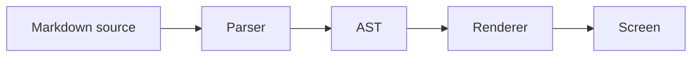

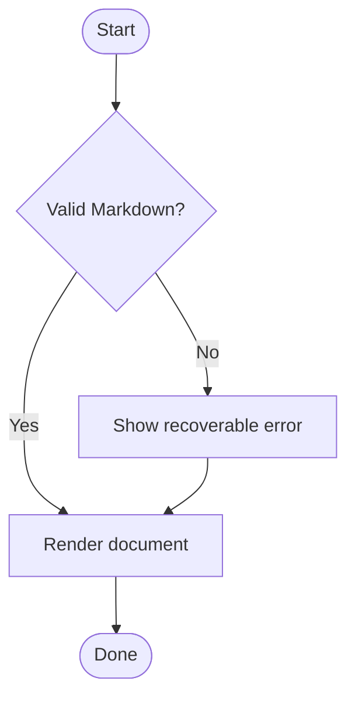

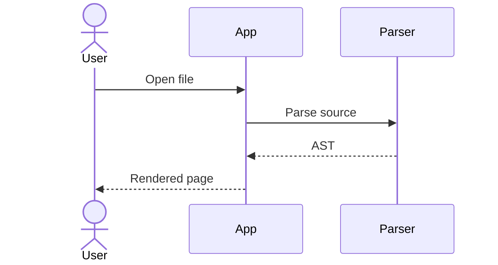

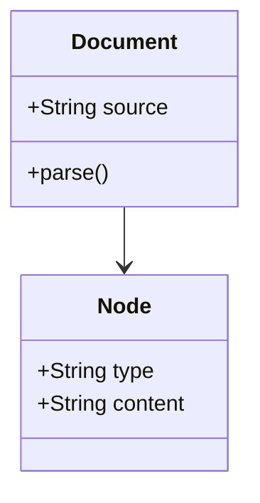

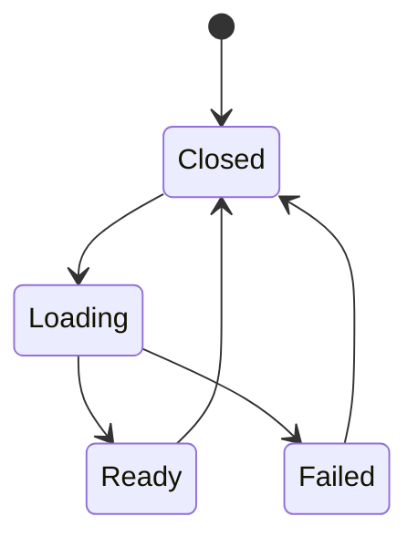

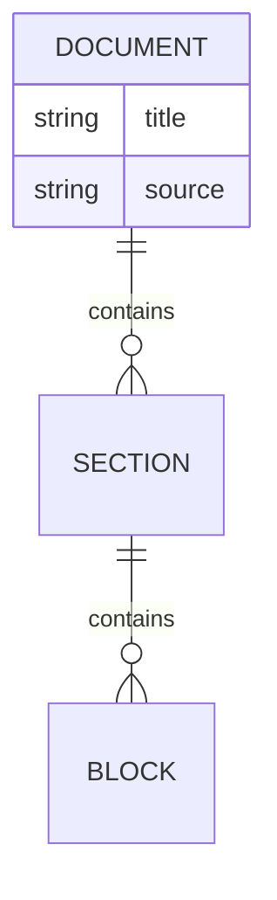

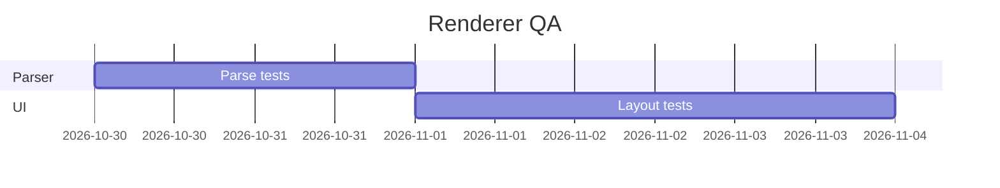

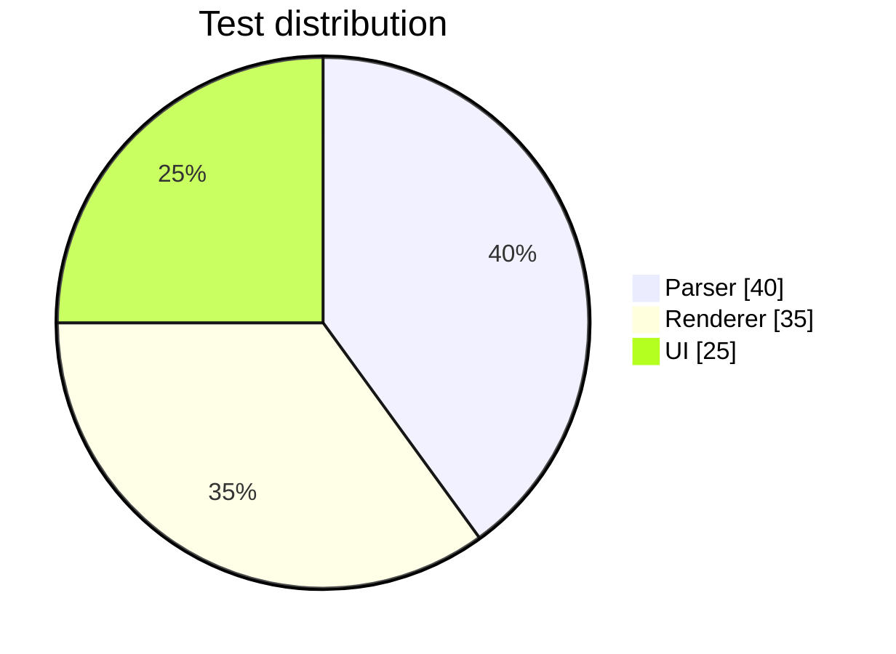

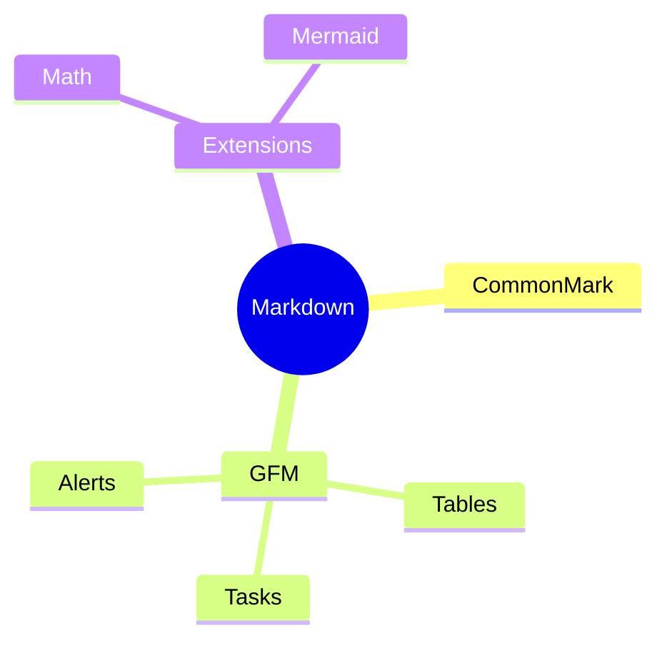

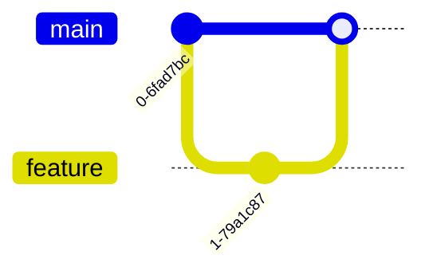

## 17. Other diagram languages and graph formats

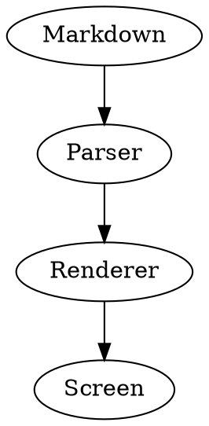

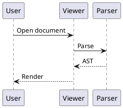

```vega-lite
{
  "data": {"values": [{"category": "A", "value": 10}, {"category": "B", "value": 20}]},
  "mark": "bar",
  "encoding": {
    "x": {"field": "category", "type": "nominal"},
    "y": {"field": "value", "type": "quantitative"}
  }
}
```

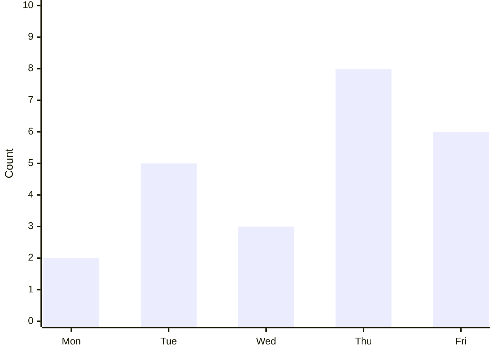

## 18. Raw HTML: safe rendering and sanitization

Inline HTML examples (renderer policy dependent):

<strong>Strong HTML</strong>

<em>Emphasized HTML</em>

<del>Deleted HTML</del>

<ins>Inserted HTML</ins>

<mark>Highlighted HTML</mark>

<kbd>Ctrl</kbd> + <kbd>Alt</kbd> + <kbd>M</kbd>

<sub>Subscript</sub> and <sup>Superscript</sup>

<abbr title="GitHub Flavored Markdown">GFM</abbr>

<details>
<summary>Click to expand details</summary>

This is content inside a details element.

- Detail item one
- Detail item two

```javascript
console.log("details content");
```
</details>

<details open>
<summary>Initially expanded details</summary>

This content starts visible.
</details>

<blockquote cite="https://example.com">
  HTML blockquote content.
</blockquote>

<figure>
  
  <figcaption>Figure caption test.</figcaption>
</figure>

<div align="center">
  Center-aligned HTML block (if allowed).
</div>

<dl>
  <dt>Markdown</dt>
  <dd>A lightweight markup language.</dd>
  <dt>Renderer</dt>
  <dd>Software that displays formatted content.</dd>
</dl>

<table>
  <thead><tr><th>HTML column</th><th>Value</th></tr></thead>
  <tbody><tr><td>One</td><td>Two</td></tr></tbody>
</table>

Unsafe elements below are test input only. They must never execute:

<script>alert("blocked")</script>


<a href="javascript:alert('blocked')">Unsafe link</a>

<iframe src="javascript:alert('blocked')"></iframe>

<svg onload="alert('blocked')"></svg>

## 19. HTML entities and special characters

&amp; &lt; &gt; &quot; &#39; &nbsp; &copy; &reg; &trade;

&#x1F680; &#128640; &#x2764; &#x1F9EA;

Literal-looking entities: `&amp;` `&#123;` `&nbsp;`

Unicode combining marks: é, ä, ñ.

Zero-width and direction markers should not crash layout: ​ ‌ ‎ ‏

Right-to-left sample: العربية 123 ABC עברית

## 20. Emoji, flags, and Unicode rendering

😀 😁 😂 🤣 😃 😄 😅 😆 😉 😊

🙂 🙃 🫠 🫡 🥹 🥲 🤔 🤯 🥳 🥶

👩‍💻 👨‍🔬 🧑‍🚀 👨‍👩‍👧‍👦

👍 👍🏻 👍🏼 👍🏽 👍🏾 👍🏿

❤️ ❤️‍🔥 ❤️‍🩹 💙 💚 💛 💜

🇮🇳 🇺🇸 🇬🇧 🇯🇵 🇩🇪 🇫🇷 🇧🇷 🇿🇦

🏳️ 🏴 🏳️‍🌈 🏳️‍⚧️

Keycaps: 0️⃣ 1️⃣ 2️⃣ 🔟

## 21. International text and bidirectional layout

- English: The quick brown fox jumps over the lazy dog.
- हिन्दी: Markdown दर्शक की जाँच।
- मराठी: हा मजकूर योग्यरीत्या दिसतो का?
- বাংলা: বাংলা অক্ষর পরীক্ষা।
- ਪੰਜਾਬੀ: ਪੰਜਾਬੀ ਲਿਖਤ ਦੀ ਜਾਂਚ।
- ગુજરાતી: ગુજરાતી લખાણ.
- தமிழ்: தமிழ் உரை சோதனை.
- తెలుగు: తెలుగు వాక్య పరీక్ష.
- ಕನ್ನಡ: ಕನ್ನಡ ಪಠ್ಯ ಪರೀಕ್ಷೆ.
- മലയാളം: മലയാളം വാചക പരിശോധന.
- اردو: اردو متن کی جانچ۔
- العربية: اختبار عرض النص العربي.
- עברית: בדיקת טקסט בעברית.
- Русский: Проверка русского текста.
- Ελληνικά: Δοκιμή ελληνικού κειμένου.
- Français: Où est l'été ?
- Deutsch: Straße, Größe, Fußball.
- Español: ¡Hola! ¿Cómo estás?
- 日本語: Markdown の表示テストです。
- 中文: 这是一个 Markdown 渲染测试。
- 한국어: 마크다운 렌더링 테스트입니다.

## 22. Lists: numbering, markers, and nesting edge cases

1. First item
1. Second item
1. Third item

3. Start numbering at three
4. Continue numbering

0. Zero item
1. Next item

- Hyphen item
* Asterisk item
+ Plus item

- Mixed marker parent
  * Asterisk child
    + Plus grandchild
      - Hyphen great-grandchild

1. Ordered parent
   - Unordered child
     1. Ordered grandchild
        - Unordered great-grandchild

1. Item with paragraph

   A second paragraph in the same item.

2. Item after the paragraph.

- Item with a blockquote

  > Nested quote.

- Item with a horizontal rule

  ---

- Item with a table

  | A | B |
  | --- | --- |
  | 1 | 2 |

## 23. Definition lists and description-list extensions

Markdown
: A lightweight markup language.

GitHub Flavored Markdown
: GitHub's extended Markdown dialect.

Parser
: Reads Markdown source and creates a structured representation.

Renderer
: Converts structured content into a visual presentation.

Term with **formatting**
: Definition with *emphasis* and `code`.

Multiple definitions
: First definition.
: Second definition.

## 24. Superscript, subscript, and typography extensions

Water: H~2~O

Carbon dioxide: CO~2~

Square: x^2^

Exponent: 2^10^

Footnote-like text: word^note^

Typography: (c) (r) (tm) ... -- --- "quotes" 'quotes'

Some engines convert these to © ® ™, ellipses, en dashes, em dashes, or curly quotes; others preserve the source.

## 25. Abbreviations and custom containers

*[HTML]: HyperText Markup Language
*[GFM]: GitHub Flavored Markdown

HTML and GFM are common abbreviations in documentation.

::: note
A fenced container extension. If unsupported, show the source safely.
:::

::: warning Custom warning
Custom container with a title.
:::

::: details Click to expand
Container details may be extension-specific.
:::

## 26. Comments and metadata

<!-- This is an HTML comment and should not be visible in rendered mode. -->

Visible text after an HTML comment.

---
title: Front Matter Test
author: QA
tags:
  - markdown
  - parser
  - viewer
---

The front matter above is intentionally placed mid-document. Test whether the renderer treats it as ordinary text or metadata according to its documented behavior.

<!--
Multiline comment:
- hidden item
- another hidden item
-->

## 27. URLs, email addresses, and linkification edge cases

https://example.com

http://example.com

https://example.com/path?one=1&two=2#fragment

https://example.com/a_(b)

https://example.com/trailing-period.

(https://example.com/inside-parentheses)

www.example.org

ftp://example.org/resource

mailto:hello@example.com

name+tag@example.co.uk

not-a-url.example

localhost:8080/path

127.0.0.1:3000

## 28. Long strings and wrapping stress

Unbroken word:
`ABCDEFGHIJKLMNOPQRSTUVWXYZabcdefghijklmnopqrstuvwxyz0123456789ABCDEFGHIJKLMNOPQRSTUVWXYZabcdefghijklmnopqrstuvwxyz0123456789`

Long URL:
https://example.com/a/very/long/path/with/many/segments/that/should/not/force/the/whole/document/to/become/wider?parameter=one&another=two&third=three

Long identifier:
`THIS_IS_A_SINGLE_IDENTIFIER_WITH_NO_NATURAL_BREAKS_0123456789_ABCDEFGHIJKLMNOPQRSTUVWXYZ_abcdefghijklmnopqrstuvwxyz_0123456789_ABCDEFGHIJKLMNOPQRSTUVWXYZ`

Long inline code: `const extraordinarilyLongVariableNameWithoutAnySpaces = "a very long value that tests horizontal scrolling and wrapping";`

## 29. Whitespace, blank lines, and line endings

Paragraph one.


Paragraph two after multiple blank lines.

Paragraph with trailing spaces.   

Paragraph with a tab:	alpha	beta	gamma

Paragraph with non-breaking spaces: A B C.

Paragraph with Unicode line separator: A
B.

Paragraph with Unicode paragraph separator: A
B.

## 30. Escaping and delimiter collision tests

\*not emphasis\*

\**not bold** 

\_not italic_

\__not bold__

\~\~not strike\~\~

\# not a heading

\> not a blockquote

\[not a link](https://example.com)

\`not code`

\\ backslash

Literal characters: \* \_ \` \# \[ \] \( \) \{ \} \. \! \|

Delimiter run: **bold *nested italic* bold**

Delimiter run: *italic **nested bold** italic*

Delimiter run: ~~strike **bold** strike~~

Delimiter run: `code with 'quotes' and "double quotes"`

## 31. HTML block parsing boundaries

<div>
This HTML block contains a paragraph.

**Markdown inside raw HTML may or may not be parsed**, depending on the Markdown engine.
</div>

<div>

A blank line inside the HTML block.

- List item inside HTML.

</div>

Text immediately after a closing HTML block.

## 32. Thematic breaks and separator ambiguity

---

***

___

- - -

* * *

_ _ _

Text above
---
Text below

Not a thematic break:
- - item
* * item
_ _ item

## 33. File paths, mentions, and issue-like references

`README.md`

`src/main/java/Main.java`

`../assets/logo.svg`

`C:\Users\Public\Documents\test.md`

`/usr/local/share/markdown`

@octocat

#123

owner/repository#456

SHA-like text: `0123456789abcdef0123456789abcdef01234567`

Commit-like text: `abcdef1234567890abcdef1234567890abcdef12`

These are plain text unless the hosting platform adds special mention or reference linking.

## 34. Footnote and reference-definition edge cases

Footnote reference with punctuation.[^punctuation]

Footnote reference inside a sentence[^inline]without a space.

Unknown footnote reference.[^not-defined]

[^punctuation]: Footnote punctuation test.
[^inline]: Footnote with no surrounding spaces.

Duplicate reference definitions:

[duplicate-ref]: https://example.com/first
[duplicate-ref]: https://example.org/second

[Duplicate reference test][duplicate-ref]

## 35. Performance: repeated blocks

### Repeated block A

A short paragraph repeated to test virtualized rendering, layout measurement, and scrolling stability.

### Repeated block B

A short paragraph repeated to test virtualized rendering, layout measurement, and scrolling stability.

### Repeated block C

A short paragraph repeated to test virtualized rendering, layout measurement, and scrolling stability.

### Repeated block D

A short paragraph repeated to test virtualized rendering, layout measurement, and scrolling stability.

### Repeated block E

A short paragraph repeated to test virtualized rendering, layout measurement, and scrolling stability.

```text
Repeated code sample 1
Repeated code sample 2
Repeated code sample 3
Repeated code sample 4
Repeated code sample 5
Repeated code sample 6
Repeated code sample 7
Repeated code sample 8
Repeated code sample 9
Repeated code sample 10
```

| Index | Value | State |
|---:|---|---|
| 1 | Alpha | Pass |
| 2 | Beta | Pass |
| 3 | Gamma | Pending |
| 4 | Delta | Pending |
| 5 | Epsilon | Fail |
| 6 | Zeta | Pass |
| 7 | Eta | Pass |
| 8 | Theta | Pending |
| 9 | Iota | Pass |
| 10 | Kappa | Pass |

## 36. Renderer behavior matrix

| ID | Feature | Input type | Expected behavior |
|---:|---|---|---|
| 001 | Heading anchors | Duplicate headings | Unique stable IDs |
| 002 | Task lists | Checked task | Visible checked state |
| 003 | Alerts | `[!WARNING]` | Warning callout or safe quote |
| 004 | Tables | Wide table | Horizontal scroll or responsive layout |
| 005 | Images | Broken URL | Alt text or fallback |
| 006 | Links | `javascript:` URL | Block or neutralize |
| 007 | Code | Unknown language | Plain-text fallback |
| 008 | Math | Unclosed delimiter | No document crash |
| 009 | Mermaid | Invalid graph | Show source or error |
| 010 | HTML | Script element | Never execute |
| 011 | Unicode | RTL text | Correct direction handling |
| 012 | Long line | Unbroken token | No page-wide overflow |
| 013 | Footnote | Repeated reference | Correct reference behavior |
| 014 | Nested list | Four levels | Correct indentation |
| 015 | Copy | Code block | Exact source copied |

## 37. Accessibility and interaction checks

- [ ] Heading hierarchy is navigable.
- [ ] Heading anchors have stable IDs.
- [ ] Links have descriptive labels.
- [ ] Links can be focused by keyboard.
- [ ] Focus indicators are visible.
- [ ] Task controls expose accessible names.
- [ ] Checked and unchecked tasks are distinguishable without color alone.
- [ ] Images expose alt text.
- [ ] Decorative images can use empty alt text.
- [ ] Tables expose header relationships.
- [ ] Code blocks can be selected.
- [ ] Copy-code controls have accessible labels.
- [ ] Alerts are understandable to screen readers.
- [ ] Text zoom does not clip content.
- [ ] High-contrast mode remains readable.
- [ ] RTL text does not reorder punctuation incorrectly.
- [ ] Motion and animated content can be reduced or paused.
- [ ] Touch targets are large enough on mobile.

## 38. Security and robustness checks

- [ ] Reject `javascript:` links.
- [ ] Reject or neutralize unsafe `data:` links.
- [ ] Sanitize event-handler attributes in HTML.
- [ ] Do not execute `<script>` elements.
- [ ] Do not execute SVG event handlers.
- [ ] Prevent unsafe iframe embedding.
- [ ] Avoid loading arbitrary local file paths.
- [ ] Avoid exposing app-private paths through links.
- [ ] Handle malformed UTF-8 safely.
- [ ] Handle extremely deep nesting without stack overflow.
- [ ] Handle extremely long lines without freezing.
- [ ] Handle huge tables without unbounded layout work.
- [ ] Handle repeated image failures without retry loops.
- [ ] Do not let malformed syntax hide the rest of the document.
- [ ] Treat Markdown source as untrusted input.

## 39. Mobile and responsive layout checks

- [ ] Test at 320 px viewport width.
- [ ] Test at 360 px viewport width.
- [ ] Test at 390 px viewport width.
- [ ] Test at 480 px viewport width.
- [ ] Test tablet portrait.
- [ ] Test tablet landscape.
- [ ] Test desktop wide layout.
- [ ] Test font scaling at 100%, 125%, 150%, and 200%.
- [ ] Test landscape rotation while scrolled.
- [ ] Test code blocks with horizontal scrolling.
- [ ] Test tables with horizontal scrolling.
- [ ] Test images wider than the viewport.
- [ ] Test long URLs and long identifiers.
- [ ] Test selection and copy on touch devices.
- [ ] Test link tapping near adjacent text.
- [ ] Test dark mode and light mode.
- [ ] Test system theme switching while the document is open.

## 40. Extended final checklist

- [ ] CommonMark block parsing
- [ ] CommonMark inline parsing
- [ ] GFM tables
- [ ] GFM task lists
- [ ] GFM strikethrough
- [ ] GFM autolinks
- [ ] GFM disallowed raw HTML behavior
- [ ] GitHub alerts
- [ ] GitHub-style heading anchors
- [ ] Reference links
- [ ] Reference images
- [ ] Duplicate reference definitions
- [ ] Nested blockquotes
- [ ] Nested lists
- [ ] Lists containing code
- [ ] Lists containing tables
- [ ] Lists containing blockquotes
- [ ] Tables containing inline formatting
- [ ] Tables containing escaped pipes
- [ ] Tables with empty cells
- [ ] Fenced code with backticks
- [ ] Fenced code with tildes
- [ ] Nested fenced examples
- [ ] Unknown code language fallback
- [ ] Syntax highlighting for many languages
- [ ] Diff highlighting
- [ ] Inline math
- [ ] Display math
- [ ] Matrix math
- [ ] Piecewise math
- [ ] Mermaid flowcharts
- [ ] Mermaid sequence diagrams
- [ ] Mermaid class diagrams
- [ ] Mermaid state diagrams
- [ ] Mermaid Gantt charts
- [ ] Mermaid pie charts
- [ ] Mermaid mind maps
- [ ] Raw HTML sanitization
- [ ] Details and summary
- [ ] Keyboard tags
- [ ] Subscript and superscript
- [ ] Abbreviations
- [ ] Definition lists
- [ ] Footnotes
- [ ] Unicode and emoji
- [ ] Right-to-left scripts
- [ ] Long content performance
- [ ] Search and heading navigation
- [ ] Copy and share behavior
- [ ] Safe external link handling
- [ ] Image fallback handling
- [ ] Accessibility checks
- [ ] Mobile responsive layout
- [ ] Light and dark themes
- [ ] Parser error recovery

**End of extended compatibility suite.** 🎉
